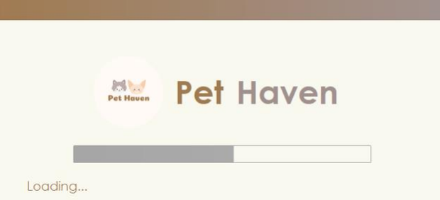
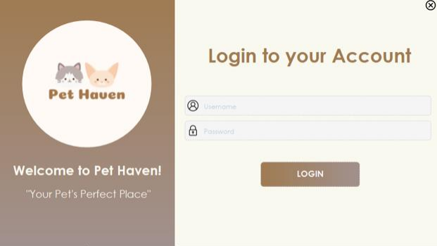
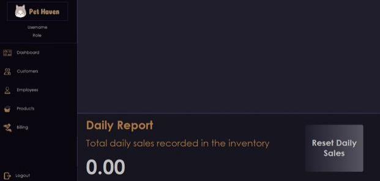
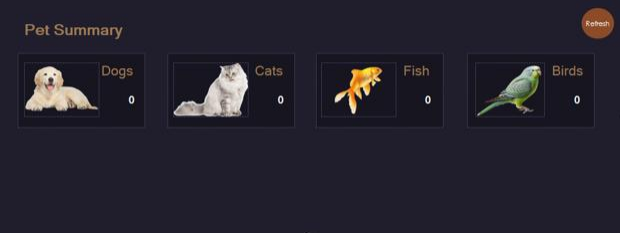
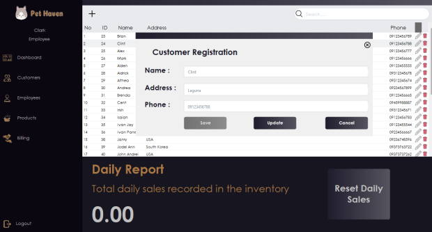
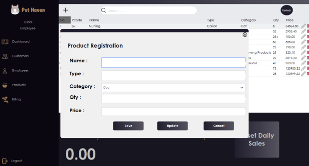
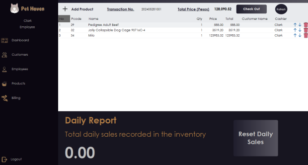
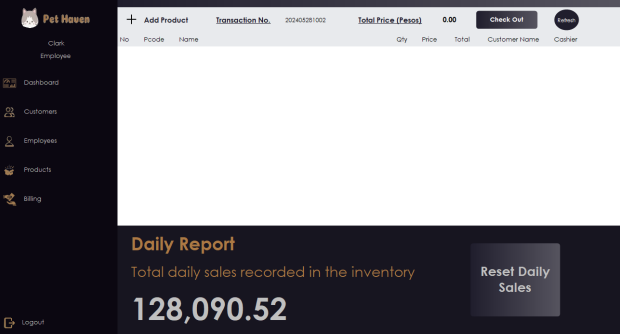

# 🐾 Pet Haven

**Pet Store Management System** · `Desktop`

Complete pet store management system with customer registration, product inventory, billing/POS, and daily sales reporting.

## Why This Project

A neighborhood pet store runs on a whiteboard, a cash drawer, and whoever happens to be at the counter. Stock counts drift out of sync with reality, "who bought the last aquarium" lives only in a staff member's head, and end-of-day totals are reconstructed from a pile of receipts. Pet Haven was built as a school project to digitize that whole loop — inventory, customers, employee accounts, checkout, and daily sales — in one desktop application the whole staff can share.

Mark served as **technical lead of a team of six**, designing the SQL Server schema, the database access layer, and the point-of-sale flow, and coordinating the team's forms into a single shell with sidebar navigation. The centerpiece was the billing pipeline: product lookup, live totals, customer attribution, cash/change handling, and a printed QR-coded PDF receipt — the one screen where every other module converges.

## How It Works

The store opens and the splash screen masks the SQL Server connection while the brand's cartoon pet logo and progress bar reassure the cashier the app is coming up. The login dialog appears — "Welcome to Pet Haven!" — and the cashier, Liza, signs in with her employee credentials. The system checks her name and password against the employee table, greets her by name, and opens the main shell with her username and role displayed in the corner.

The dashboard loads first: four big category cards — Dogs, Cats, Birds, Fish — each showing a live stock count pulled from the product table. Liza can see at a glance that fish stock is running low before a customer asks for the last betta.

A regular, Mrs. Santos, walks in with a shopping list. Liza clicks **Cash** and the billing form opens with a fresh transaction number. She clicks Add, searches the product catalog, and rings up a bag of dog food, a cage, and some treats — quantities can be bumped up or down right in the grid, and the total recalculates live. When the cart is ready, she clicks Checkout, picks Mrs. Santos from the customer picker, and the customer's ID is stamped onto the transaction. She enters the cash tendered, the change is computed, and checkout completes: the PDF receipt is generated with an embedded QR code encoding the transaction number, the Daily Report updates with the new cumulative total, and the Transaction button lights up for reviewing the sale later.

If Mrs. Santos were new, Liza would have registered her first — name, address, phone — from the customer module, and she would then appear in the checkout picker immediately. Before the store opened, the manager had already used the same shell to add incoming puppies to inventory and register a new part-time employee; every one of those records flows into the same SQL Server database the POS reads from, so the numbers Liza sees at checkout are the numbers the manager sees on the dashboard.

## Modules

### Splash & Employee Login
The launch screen hides database connection setup behind branded progress feedback; the login dialog authenticates employees against the employee table by name and password, returning a welcome message with the employee's name and role before opening the main shell.

**Scenario:** Liza arrives for her shift, types her credentials, and gets "Welcome Liza!" — her cashier role travels with her into the main form and onto every receipt she issues.

### Main Application Shell
A fixed-size sidebar shell hosting Dashboard, Customers, Employees, Products, Cash (billing), and — after a completed sale — Transaction history, with the logged-in username and role always visible and a Daily Sales total on the home view.

**Scenario:** From one window the manager checks stock on the dashboard, jumps to Employees to onboard a hire, then hands the same machine to Liza who goes straight to Cash — no restarts, no separate apps.

### Dashboard & Live Inventory Overview
Four animal-category cards (Dogs, Cats, Birds, Fish) show live quantities aggregated from the product table, refreshing whenever the form is activated or stock changes — a purpose-built "is anything about to run out?" view.

**Scenario:** The manager glances at the dashboard before opening: Fish reads 2. He adds a delivery of ten fish in Products, and the card ticks up to 12 the next time the dashboard is shown.

### Customer Management
Registers and maintains the customer roster — name, address, phone — that feeds both checkout attribution and sales records. New customers can be created on the spot and immediately become selectable in the billing flow.

**Scenario:** A first-time buyer has no record; Liza opens Customers, captures her details in a modal, and by the time she returns to checkout the new customer is available in the picker.

### Employee Management
Full CRUD for staff accounts, including the role assigned at login — the same table the authentication query reads, so adding an employee in this module automatically grants system access.

**Scenario:** The store hires a weekend cashier; the manager registers her name, password, and role, and she can log in on her first day with no extra configuration.

### Product Inventory
Catalog management across product code, name, type, animal category (Dog/Cat/Bird/Fish), quantity, and price — with delete-aware quantity tracking so the dashboard counts stay honest as stock moves.

**Scenario:** A shipment of dog cages arrives; the manager adds them under the Dog category with quantity and price, and the product grid and category totals update for everyone.

### Point-of-Sale Billing
The revenue engine: transaction numbers are generated per sale, products are added via a catalog picker, quantities are adjusted in-grid with live totals, a customer is chosen before checkout is enabled, cash/change are handled, and completing the sale writes the records and fires the receipt.

**Scenario:** Liza rings up ₱128,090.52 worth of goods, selects Mrs. Santos, takes her cash, and the form confirms the sale — the cart clears, the daily total climbs, and the transaction is now a permanent record joined to both product and customer.

### Receipts & Transaction History
Every completed sale can produce a PDF receipt (iTextSharp) with a QRCoder-generated QR code carrying the transaction number; the Transaction screen later re-opens the full sales log with product, customer, cashier, cash, and change columns.

**Scenario:** Two days later a customer asks for proof of purchase; the manager opens Transactions, finds the sale by number, and regenerates the QR-stamped receipt for her records.

## Screenshots

### Application launch — the loading screen masks database connection initialization while reinforcing the brand with the cartoon pet logo and progress feedback.

### Employee authentication — the login dialog restricts access to authorized staff. The "Welcome to Pet Haven!" tagline creates a friendly tone appropriate for a pet store environment.

### Manager dashboard — the home screen after login shows the sidebar (Customers, Employees, Products, Billing) and the Daily Report, giving managers an instant view of today's sales performance.

### Inventory snapshot — animal category cards (Dogs, Cats, Fish, Birds) show live stock counts. When counts drop, managers know it's time to reorder before a pet runs out.

### Customer onboarding — the registration modal captures name, address, and phone when a new customer makes their first purchase. This data feeds loyalty tracking and receipt printing.

### Product catalog management — the registration modal adds new products with type, category, quantity, and price. Essential for tracking inventory levels and pricing across the store.

### Point-of-Sale checkout — rings up items (dog food, cage, treats), calculates the total (₱128,090.52), and processes payment. This is the primary revenue-generating screen of the system.

### Post-sale confirmation — after checkout, the transaction list clears and the Daily Report updates with the new total. Managers can track cumulative sales throughout the business day.

## Features

- Admin dashboard with daily sales reports
- Customer registration and management
- Employee management
- Product inventory with categories
- Billing / Point-of-Sale with checkout
- Pet category tracking (dogs, cats, fish, birds)

## Tech Stack

- C#
- WinForms
- .NET
- SQL Server

## About

A Windows Forms desktop application for managing a pet store. Features a point-of-sale system, customer and employee databases, product inventory tracking, and daily sales reporting. Built with a clean dark sidebar navigation layout.

---

Built by [Mark Crysler Baddo](https://github.com/Kuraisura) · [Portfolio](https://kuraisler.xyz)
